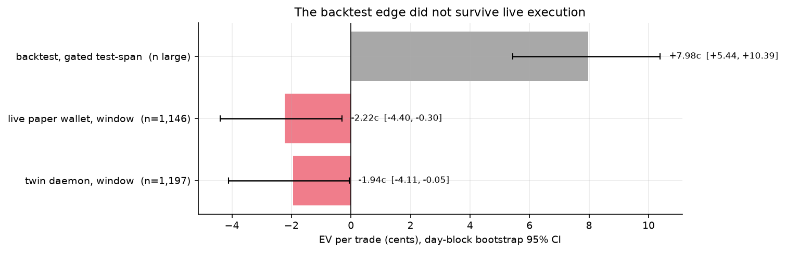
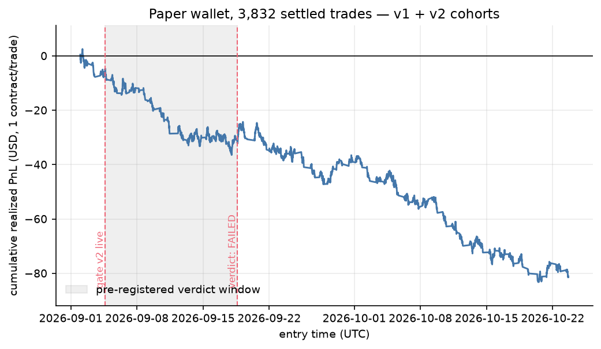
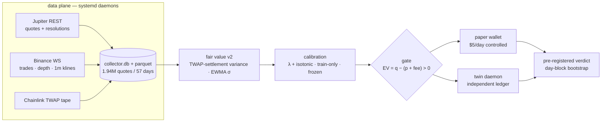
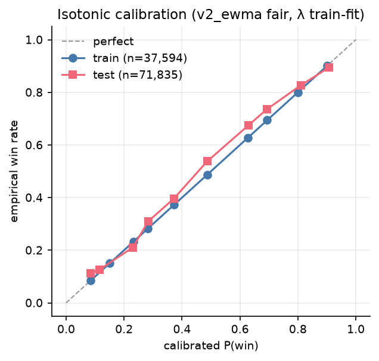
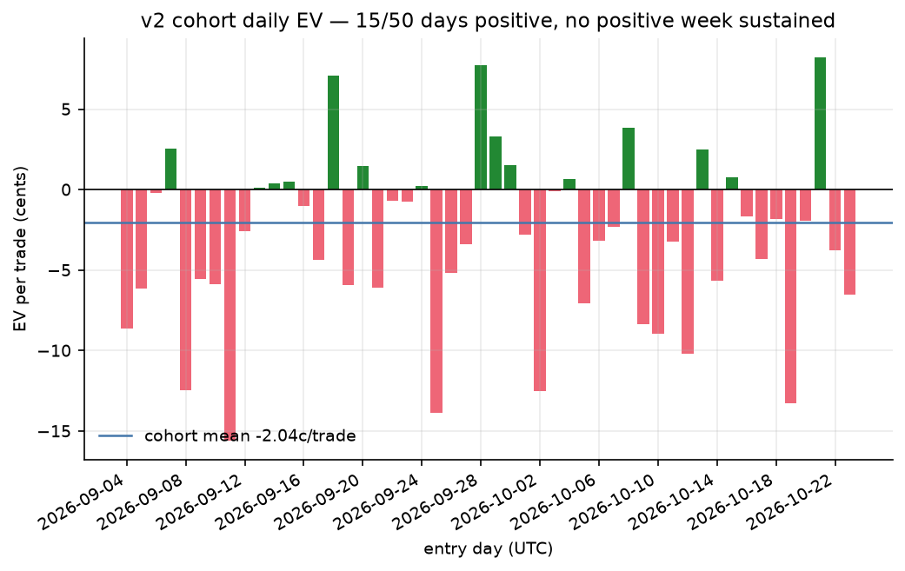

# quant-btc — pricing and falsifying short-horizon crypto Up/Down binaries


<!-- After pushing to GitHub, replace the static badges above with the real one:
      -->

An end-to-end microstructure research program on 5-minute / 15-minute
BTC/ETH/SOL **Up/Down binary prediction markets** (Jupiter Prediction,
Chainlink-TWAP-settled): 57 days of always-on tick collection, a
venue-accurate fair-value model, train-only calibration, and a live
paper-trading falsification governed by a **pre-registered verdict rule**.

**The result is an honest negative.** The gate's backtested edge
(**+7.98c**/trade across 29,350 gated historical entries) did not survive
live paper execution: **−2.22c**/trade over the pre-registered two-week
window (n = 1,146, day-block bootstrap 95% CI **[−4.40, −0.30]**, zero of
three weeks positive), independently confirmed by a twin daemon running the
identical signal into its own ledger. Per the rule written before the window
opened, the strategy was retired — no capital was ever deployed.

| Backtest expectation vs live realization (95% CI, day-block bootstrap) | Cumulative paper PnL, both cohorts |
|---|---|
|  |  |

## The question

Binary Up/Down markets quote a price `p` for "close above strike". If your
model's true probability `q` satisfies `EV = q − (p + fee) > 0` at the
observed ask (venue taker fee `0.07·p·(1−p)`, rounded up to the cent), a
taker entry has positive expectation. Backtests of exactly this rule looked
strongly positive. The question this repo answers: **does that edge survive
contact with live quotes, or is it an artifact of stale marks, fee neglect,
and adverse selection?** Answer, measured rather than argued: it does not
survive.

## Architecture



## Methodology — what made the test credible

1. **Venue-accurate fair value.** Settlement is a 60-second TWAP against the
   window-open strike, so the fair value uses the variance of the settlement
   average — `Var(S) = σ²(d−w) + σ²·w/3` — in log space with an EWMA(30m
   halflife) σ, not an endpoint-price Black–Scholes digital.
   [`fair_v2.py`](research/staleness/fair_v2.py),
   [`gate_v2.py`](research/staleness/gate_v2.py),
   [`tests/research/test_fair_v2.py`](tests/research/test_fair_v2.py).
2. **Train-only calibration.** Logistic temperature λ + isotonic mapping fit
   strictly on the pre-live train span, frozen to an `.npz` at deployment,
   with degeneracy guards; refits only at declared checkpoints, never
   intra-run. Reliability on the held-out span:
   
3. **Pre-registration.** The verdict rule (positive EV, CI excluding zero
   upward, all weeks positive) and the two-week window were fixed in writing
   *before* the window opened; the verdict was computed from append-only
   ledgers. [`GATE_VERDICT.md`](research/staleness/GATE_VERDICT.md),
   [`gate_verdict.py`](research/staleness/gate_verdict.py).
4. **Twin-ledger replication.** A second daemon ran the identical signal into
   an independent ledger — the negative replicates (−1.94c, CI [−4.13, +0.01]).
5. **Execution forensics.** Adverse-move-at-fill markouts against the
   collector tape: −1.75c mean at +30s over 571 fills (56.9% adverse) — the
   drag is roughly fee-sized, so the shortfall is backtest overstatement plus
   dispersion, not latency alone. [`ADV_MOVE_FILLS.md`](research/staleness/ADV_MOVE_FILLS.md).
6. **Feature bakeoffs scored on realized EV, never on IC** (IC/PnL
   non-identifiability): the first candidate — BOCPD flow-regime conditioning
   — was scored on realized per-trade EV and honestly killed (ΔEV −0.16c).
   [`BOCPD_EV.md`](research/staleness/BOCPD_EV.md).
7. **A guarded autoresearch ledger.** 29 supervised strategy trials under a
   locked evaluation harness (24-cell regime conditioning, Holm correction,
   sealed H1-2026 holdout enforced by [`guard.py`](research/guard.py)) with
   every trial logged in [`RESULTS.md`](research/RESULTS.md); deflated
   statistics applied to the full family.

## Results ledger — every line of attack, kept honest

| Line of attack | Artifact | Result | Outcome |
|---|---|---|---|
| Supervised direction models (29 trials) | [`RESULTS.md`](research/RESULTS.md) | champion walk-forward MCC 0.046 | kept, later superseded |
| RL policies (flat / curriculum / entry-forced) | [`research/rlenv/`](research/rlenv), [`research/phase_b/`](research/phase_b) | at/below random (forced-entry 49.3–49.6% acc) | **retired** |
| Staleness gate v2 — backtest | round-102 protocol | +7.98c/trade, CI [+5.44, +10.39], n = 29,350 | — |
| **Staleness gate v2 — live, pre-registered window** | [`GATE_VERDICT.md`](research/staleness/GATE_VERDICT.md) | **−2.22c, CI [−4.40, −0.30], 0/3 weeks positive** | **FAILED → retired** |
| Twin daemon, same window | [`GATE_VERDICT.md`](research/staleness/GATE_VERDICT.md) | −1.94c, CI [−4.13, +0.01] | confirms |
| Post-window extension, 5 weeks (post-hoc) | [`GATE_VERDICT.md`](research/staleness/GATE_VERDICT.md) | −1.96c, CI [−3.43, −0.54] | negative persists |
| BOCPD flow-regime conditioning | [`BOCPD_EV.md`](research/staleness/BOCPD_EV.md) | ΔEV −0.16c vs stable-flow cohort | killed |

Daily dispersion of the live v2 cohort — 15 of 50 days positive, no positive
week sustained: 

## What the negative means

The gated backtest edge (+8c) was real *as a measurement of stale marks* and
illusory *as a tradable edge*: once entries paid the quoted ask plus the
taker fee, adverse selection and fee drag consumed it, and the residual was
decisively negative. This is consistent with an independent team's public
post-mortem on the same venue class (walk-forward skill of 0.93% against a
5% requirement on filled trades — recorded in the
[external catalog](research/external/EXTERNAL_CATALOG.md)). Explicitly **not
tested** (and listed as such in the verdict): maker/resting execution, queue
position, latency-to-venue, and depth-aware sizing. Any revival requires a
candidate that first survives prospective realized-EV scoring.

## Repository tour

```
src/quantbtc/          data plane: Jupiter + Binance collectors, fee model,
                       fair value, paper trader, reports        (16 modules)
research/
  program.md             research program & phase gates
  RESULTS.md             autoresearch ledger — 29 trials, every KEEP/RESET
  guard.py, ledger.py    sealed-holdout guard + trial ledger
  locked/                frozen evaluation harness (24-cell, Holm-corrected)
  staleness/             the live falsification: fair_v2, gate_v2, both paper
                         daemons, markouts, BOCPD bakeoff, GATE_VERDICT.md
  rlenv/                 formula-loop + RL experiments (negatives kept)
  phase_b/               official-label supervised retraining (negative)
  external/              EXTERNAL_CATALOG.md — 236-round external research log
  litreview/             paper catalog feeding the formula queue
tests/                  85 tests (unit + research smoke), no network needed
docs/                   DESIGN, RECON, OPERATIONS runbook, figures
scripts/                API recon + figure generation (this README's charts)
config/                 single config.yaml — no paths or keys in code
```

## Reproducing

    python3.11 -m venv .venv
    .venv/bin/pip install -e '.[dev,research]'
    .venv/bin/pytest -q -m "not integration"        # 85 tests

Regenerate the README figures from the local ledgers (requires `data/`, see
below): `.venv/bin/python scripts/make_figures.py`. Recompute the verdict
deterministically (seed fixed): `.venv/bin/python research/staleness/gate_verdict.py`.

The collector/paper daemons are **retired**; [`docs/OPERATIONS.md`](docs/OPERATIONS.md)
is the runbook to resume them (systemd user units, `.env` API key).

## Data & provenance

Collected over 57 continuous days (2026-08-27 → 2026-10-23): ~1.94M venue
quotes across 81.5k market windows, Binance trades/top-of-book/1m klines for
BTC/ETH/SOL (3,159 parquet files), and the Chainlink TWAP settlement tape.
Market data and ledgers are **not redistributed** in this repo (`.gitignore`d
under `data/`); the tracked artifacts — score parquets, frozen calibration,
all analysis scripts and tests — reproduce every number above from them.
The frozen 5m/15m supervised-training dataset (2025-08→2026-08, ~561k bars)
is external; point `config/config.yaml: research.data_5m/data_15m` at a
local copy if re-running the strategy ledger.

## Status, license, disclaimer

Research phase concluded 2026-10 with the pre-registered negative verdict;
paper trading only — **no live capital was ever deployed**. Nothing here is
financial advice. MIT license (see [LICENSE](LICENSE)).
